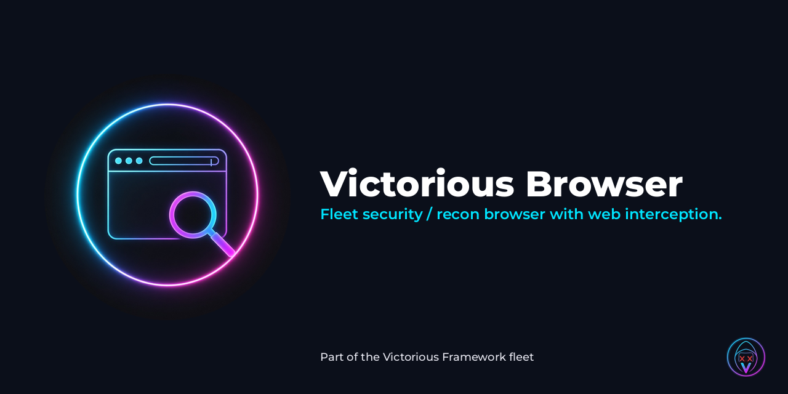

<div align="center">



# Victorious Browser

**Fleet security / recon browser with web interception.**

Works on its own; fleet integration (droidcommand-AI) is optional

<p>
  
  <a href="https://github.com/Victorious93/victorious-browser/actions/workflows/android.yml"></a>
  <a href="https://victorious-framework.pages.dev"></a>
</p>

</div>

## Features

- Opens straight into the browser. Fleet tools live in a menu (ring logo, overflow menu, or new-tab chips).
- Tabs, address bar, history, bookmarks, downloads, find-in-page, custom search engine, Desktop site, reader mode, sandboxes, and link previews with a sandboxed viewer.
- Sites just work: file uploads, fullscreen video with Picture-in-Picture, and `mailto` / `tel` / `sms` / `geo` (and related) link handling.
- On-device intercepting proxy for this app's own WebView traffic (LittleProxy on localhost, local inspection CA): HTTP history, modify-and-replay, cookies, JWT decode, console, storage, and HAR export.
- Deep Research OSINT hub: dork composer, phone / email / username / domain-IP lookups, reverse image search, and a case notebook. Public sources only.
- Opt-in privacy protections, including Fire, Fireproof, and a Privacy Dashboard.
- Mesh reachability: resolve and probe mesh-flagged fleet panels before opening them.
- Optional fleet control bridge (`EXTERNAL_NODE` in the droidcommand-AI protocol). External control is off by default; the browser's core features work without it.
- Also in the Fleet tools menu: recon workbench, scanner, fuzz/templates, Net ID / spoof, defensive anti-phish, userscript extensions (not Chrome / `.crx` extensions), inspection-CA helper, evidence logger, fleet export, and a Metasploit RPC console.

Package id: `com.victorious.browser`.

## Screenshots

No screenshots are in the repository yet.

## Install / download

No release yet. There is no GitHub Release and no published APK to download.

Debug / pre-release builds can be assembled from source (below). These are not finished software. Install only if you understand the risk.

## Build from source

Requirements: JDK 17+, Android SDK (compile/target SDK 35, minSdk 26).

```bash
./gradlew assembleDebug
```

Debug APK: `app/build/outputs/apk/debug/app-debug.apk`

Debug builds use this repo's fixed, committed debug keystore so fleet installs update cleanly over prior builds. Release keys are never committed; they live only in CI secrets.

## Manual

How-to: [docs/MANUAL.md](docs/MANUAL.md)

The same manual is searchable in the in-app Help screen.

## License

This repository does not include a `LICENSE` file.

Third-party open-source licenses and attributions (LittleProxy and Netty under Apache-2.0, Bouncy Castle under the Bouncy Castle Licence, AndroidX, and others) are listed in [NOTICE](NOTICE).
